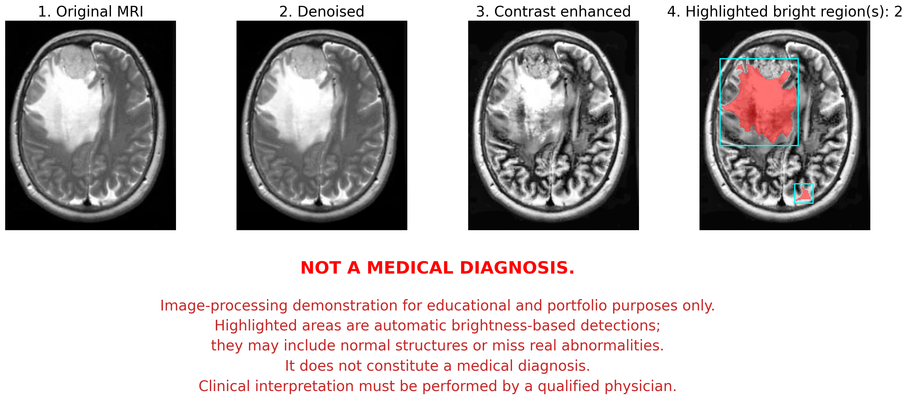

# 📖 Brain MRI Bright-Region Segmentation Demo

> A Python image-processing project, built with AI collaboration, that highlights abnormally bright regions in a brain MRI slice. I made it to learn how medical images are cleaned and analyzed.

> The program loads a real brain MRI image from Kaggle, reduces noise with Non-Local Means denoising, and applies CLAHE (Contrast Limited Adaptive Histogram Equalization) for display. Then, it uses Otsu-based thresholding on the denoised image to segment the bright regions, and visualizes every stage side by side.

> This is not a tumor detector. Brightness alone cannot tell abnormal tissue from normal bright tissue, so the output can include normal structures or miss real abnormalities. It was tested on a single slice, so results may vary greatly. Deep-learning segmentation models (CNNs such as U-Net or nnU-Net) are the next step.

## 🔬 Visual Output

**View the sample processing output:** [https://happyjasondev.github.io/mri-brain-tumor-detection-program/](https://happyjasondev.github.io/mri-brain-tumor-detection-program/)
  * On the sample slice, the program highlights two bright regions: a large one (4,868 px) and a small one (127 px). The program cannot tell what either region is. Both are only brightness-based candidates.

## ⚙️ How it Works
1. Load the image with Pillow, convert it to grayscale, and scale values to 0–1.
2. Denoise with Non-Local Means `skimage.restoration.denoise_nl_means`. The noise level is estimated automatically with a Laplacian-based method `scipy.ndimage`.
3. Enhance contrast with CLAHE `skimage.exposure.equalize_adapthist`. This image is used for display only.
4. Segment the bright regions on the denoised image (not the CLAHE image):
  * Otsu threshold to find the head, then fill holes.
  * Erode the head mask by a few pixels to exclude the bright skull ring.
  * Compute a second Otsu threshold inside the brain area, then raise it (factor 0.55) to keep only the brightest pixels.
  * Remove small objects, close small gaps, and label connected components (`skimage.morpholog`, `skimage.measure`).
5. Visualize the four stages with Matplotlib, including the highlighted regions and a disclaimer.

If there's no segmentation on the denoised image, CLAHE would stretch the contrast locally, which makes normal brain folds look bright. Thresholding on the CLAHE image produced 20 false regions in an early version. Segmenting on the denoised image gives only 2 regions.

## 📝 Known Limitations & Future Roadmap

* **Brightness is Not Enough for a Diagnosis:**  
  * **Current Limitation:** The method finds regions that are brighter than their surroundings. It has no knowledge of anatomy, so it can flag normal structures or miss real abnormalities. The small second region in the sample output is an example of an unexplained candidate.
  * **Planned Improvement:** Train or fine-tune a segmentation model on labeled data, or use classical methods to find likely regions and then filter false positives.

* **Lack of Spatial & Volumetric Context:**  
  * **Current Limitation:** Each slice is analyzed separately, without 3D continuity or texture information. The thresholds 0.55, skull_erosion=6, and min_size=120 were tuned for this specific slice and will likely need re-tuning for other images.
  * **Planned Improvement:** Transition from classical image processing to a CNN-based network such as U-Net or nnU-Net trained on multi-modal clinical datasets (BRATS).

## 🛠️ Key Features & Technical Architecture

* **Modular Image Processing Pipeline:** Reusable functions for denoising, contrast enhancement, and segmentation in `mri_pipeline.py`, with `real_mri_pipeline.py` handling image loading and segmentation for a real MRI slice.
* **Denoising & Contrast Enhancement:** Estimates the noise level with a Laplacian-based method (`scipy.ndimage`), reduces noise with Non-Local Means (`skimage.restoration`), and enhances local contrast with CLAHE (`skimage.exposure`).
* **Threshold-Based Bright-Region Segmentation:** Combines Otsu thresholding (`skimage.filters`), morphological cleanup (`skimage.morphology`), and connected-component labeling (`skimage.measure`) to isolate hyperintense regions. These are brightness-based regions, not confirmed abnormalities.
* **Multi-Stage Visualization:** Loads JPG/PNG images with `PIL` and uses `matplotlib.pyplot` to show the original, denoised, contrast-enhanced, and highlighted-region images side by side.

## 💻 Tech Stack & Dependencies

| Category | Technology / Library |
| :--- | :--- |
| **Language** | Python 3 |
| **Numerical Computing** | `NumPy`, `SciPy` (`ndimage`) |
| **Computer Vision / Processing** | `scikit_image` (`restoration`, `exposure`, `filters`, `morphology`, `measure`), `Pillow` |
| **Data Visualization** | `Matplotlib` |

## 🗂️ Data Source

The sample image comes from a public Kaggle dataset. Please check the dataset's license and attribution requirements before redistributing the image.

## ⚠️ Disclaimer

This software demonstrates algorithmic image processing techniques (isolating high-signal intensity regions) for educational and portfolio demonstration purposes only. It does not constitute a medical diagnosis. Clinical interpretation must be performed by a qualified physician.
